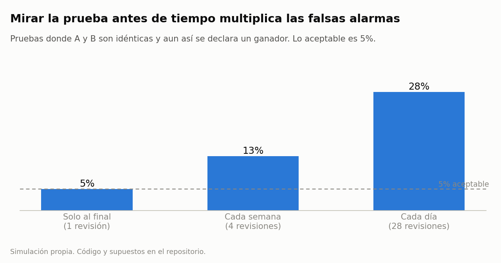
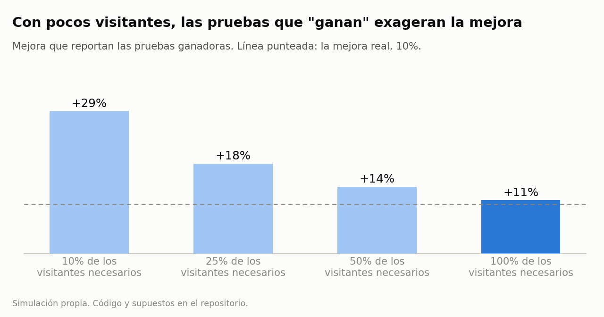

# Pruebas A/B sin trampas

**Una calculadora de pruebas A/B en español y dos simulaciones que muestran por qué tantos "ganadores" no lo son.**
Para pequeños negocios y ONGs que prueban dos versiones de un anuncio, un correo o una página.

> **English summary.** A small Python toolkit for A/B tests (sample size and two-proportion significance test, no dependencies beyond the standard library) plus two Monte Carlo simulations with NumPy. They quantify two classic traps: peeking at a running test inflates the false-positive rate from 5% to 28%, and underpowered tests that "win" report a lift almost three times the true one.

## Hallazgos

**1. Revisar la prueba todos los días y detenerla "cuando gana" casi sextuplica las falsas alarmas.** Con dos versiones idénticas, 5% de las pruebas declara un ganador si se mira una sola vez al final; 13% si se mira cada semana; 28% si se mira cada día.



**2. Con pocos visitantes, las pruebas que ganan exageran.** Si la mejora real es de 10% y la prueba se hace con una décima parte de los visitantes necesarios, solo 14% de las pruebas la detecta, y las que la detectan reportan una mejora típica de 29%.



| Visitantes usados | Pruebas que detectan la mejora | Mejora real | Mejora que reportan las ganadoras |
|---|---:|---:|---:|
| 10% de los necesarios | 14.1% | 10% | 29.0% |
| 25% | 28.7% | 10% | 18.3% |
| 50% | 51.0% | 10% | 13.6% |
| 100% | 80.0% | 10% | 10.9% |

## La calculadora

```bash
pip install -r requirements.txt
```

¿Cuántos visitantes necesito? Con una conversión actual de 3% y queriendo detectar una mejora de 10%:

```bash
python -m abtest size --baseline 0.03 --lift 0.10
```

```
Necesitas 53,211 visitantes en cada variante (106,422 en total) antes de leer el resultado.
```

¿B le ganó a A? Con 120 conversiones de 4,000 visitantes contra 151 de 4,000:

```bash
python -m abtest test --a 120/4000 --b 151/4000
```

```
A: 3.00%   B: 3.77%   cambio: +25.8%
Valor p: 0.055. No hay evidencia suficiente: la diferencia puede ser azar.
Diferencia plausible: de -0.02% a +1.57% (puntos porcentuales).
```

Un cambio de +25.8% parece enorme y aun así puede ser azar: ese es el punto del proyecto.

## Reglas prácticas

1. Calcula el tamaño de muestra **antes** de empezar y no leas el resultado hasta alcanzarlo.
2. Si no puedes juntar esos visitantes, prueba cambios más grandes o acepta que no podrás distinguirlos.
3. Desconfía de mejoras espectaculares en pruebas pequeñas.

## Método y supuestos

- **Tamaño de muestra y significancia:** prueba z de dos proporciones, bilateral, con 5% de significancia y 80% de potencia. Los resultados coinciden con ejemplos de libro de texto y con un cálculo a mano (ver [`tests/`](tests/test_abtest.py)).
- **Simulación de falsas alarmas:** 20,000 pruebas A/A de 28 días, 500 visitantes diarios por variante, conversión de 3%.
- **Simulación de ganadoras exageradas:** 200,000 pruebas por escenario, conversión de 3%, mejora real de 10%. La "mejora reportada" es la mediana entre las pruebas donde B gana con significancia.
- Las simulaciones usan una semilla fija, así que los números se reproducen exactamente: `python -m abtest simulate`.

## Limitaciones

- Es una prueba de horizonte fijo. Existen métodos secuenciales que sí permiten revisar antes de tiempo; este proyecto no los implementa.
- Supone visitantes independientes y una sola métrica de conversión.
- Los porcentajes de las simulaciones dependen de los supuestos; con otra conversión u otro tráfico cambian las cifras, no la conclusión.

## Licencia

Código bajo licencia MIT.
